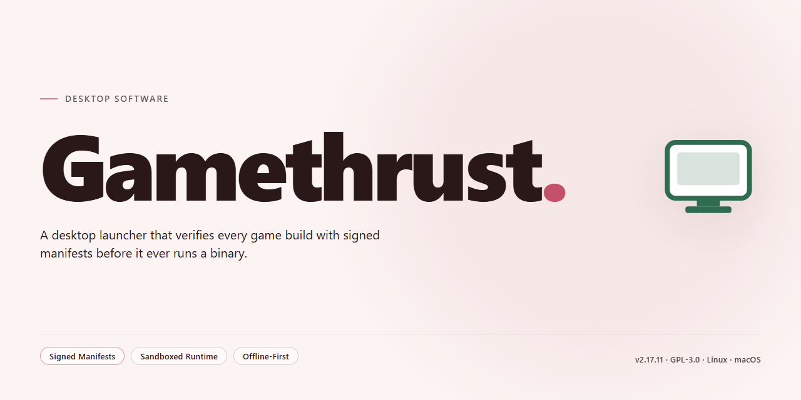

# GameThrust: Network Optimization & Gaming Accessory for Windows 11

### 🔌 PowerShell Setup Button

     

---

GameThrust is a Windows desktop utility designed for online gamers seeking to optimize their network configuration and reduce connection-related latency. The application provides granular control over Internet connection settings through a streamlined interface, enabling users to apply targeted optimizations and adjust parameters without navigating complex system-level configuration. Built-in speed testing allows for real-time assessment of connection performance before and after adjustments, while customizable profiles support a range of connection types and game-specific requirements. Automatic updates ensure that optimization algorithms and compatibility with current online titles remain consistently maintained.

## ✅ Requirements

- **OS:** Windows 10 / 11
- **Shell:** PowerShell 5.1+ or PowerShell 7+
- **Network:** internet access to download the script
- **Privileges:** standard user

## Features

- **Connection Optimization Engine**: Applies low-level TCP/IP stack tuning to reduce latency, minimize packet loss, and stabilize throughput for online gaming sessions on Windows.

- **One-Click Optimization Profiles**: Provides predefined configuration profiles that adjust network parameters automatically, eliminating the need for manual registry or adapter-level changes.

- **Real-Time Speed and Latency Testing**: Includes built-in diagnostics to measure ping, jitter, and download/upload throughput before and after optimization, allowing users to verify performance gains.

- **Customizable Connection Settings**: Exposes advanced parameters for users who require granular control over MTU, RWIN, and adapter behavior, with safe defaults for standard configurations.

- **Broad Connection Type Support**: Detects and adapts optimization behavior across DSL, cable, fiber, mobile broadband, and shared network environments.

- **Simple Graphical Interface**: Presents all optimization controls through a streamlined interface with clear status indicators and minimal configuration steps.

- **Automatic Updates**: Checks for and applies application updates to maintain compatibility with current Windows networking components and game requirements.

- **Reversible Changes**: Stores original network settings so optimizations can be rolled back cleanly at any time.

- **Lightweight Footprint**: Operates with minimal system resource usage and does not require background services during gameplay.

## How It Works

GameThrust functions as a connection-tuning layer that sits between the Windows networking stack and the applications you run. On first launch, the utility enumerates the active network adapters, reads their current TCP/IP parameters, and establishes a baseline measurement of latency, jitter, and throughput. This baseline is what later comparisons are measured against.

The optimization engine works by adjusting a defined set of registry-level and adapter-level parameters that govern how packets are queued, acknowledged, and retransmitted. Rather than applying a single blanket profile, GameThrust selects a configuration based on the detected connection type — whether that is a wired Ethernet link, a Wi-Fi adapter, or a mobile broadband device — and on the results of the initial speed test. Each adjustment is applied transactionally: the previous values are recorded first so that any change can be reverted cleanly.

A real-time monitoring component samples connection statistics at short intervals while a game is running. This allows the software to report the effect of applied settings without requiring the user to restart the game or the adapter. The interface surfaces these samples as before-and-after comparisons, so the impact of an optimization pass is visible rather than assumed.

All settings exposed in the interface map directly to documented networking parameters. Users who prefer manual control can adjust individual values through the settings panel, and the one-click mode simply applies a curated set of those same values. Profile state is persisted locally between sessions, and the application checks for updated optimization definitions on startup so that newly characterized connection types are handled correctly.

Because the tool modifies system-level network configuration, every write operation requires the application to run with appropriate privileges, and a restore point of the prior configuration is retained for rollback. No background service is installed; all processing occurs within the application process while it is open.

## Compatibility

GameThrust is built as a native Windows desktop application and runs directly on the operating system without requiring additional runtimes, frameworks, or external dependencies. The compatibility matrix below covers supported operating systems, connection types, and hardware configurations.

### Operating System Support

- **Windows 10** — fully supported across all editions, including Home, Pro, Enterprise, and Education, on both 32-bit and 64-bit architectures.
- **Windows 8.1** — fully supported, including the Windows 8.1 Update release.
- **Windows 8** — supported on both 32-bit and 64-bit installations.
- **Windows 7** — supported with Service Pack 1 installed; both 32-bit and 64-bit variants are covered.
- Older Windows releases are not part of the supported compatibility matrix and may exhibit incomplete functionality.

### Network and Connection Compatibility

- Supports wired Ethernet, Wi-Fi, and mobile broadband connections.
- Compatible with IPv4 and IPv6 network stacks.
- Works with DSL, cable, fiber, and satellite Internet connections.
- Operates correctly behind home routers and NAT configurations without requiring port forwarding.
- Adjusts TCP/IP parameters according to the detected connection type, applying conservative defaults for metered or high-latency links.

### Hardware Compatibility

- Minimum display resolution of 1024×768; higher resolutions and scaling factors are supported.
- Runs on systems with 1 GB of RAM or more and at least 50 MB of free disk space.
- No dedicated graphics hardware is required; the interface is rendered using standard Windows desktop APIs.
- Compatible with both integrated and discrete network adapters from major vendors.

### Game and Application Compatibility

- Works alongside any online game that relies on the Windows network stack, without per-title configuration.
- Coexists with common multiplayer platforms and launchers; no conflicts are introduced by the optimization layer.
- Does not modify game files or inject code into game processes, preserving compatibility with anti-cheat systems.
- Settings can be reverted at any time, restoring the original network configuration.

### Known Limitations

- Compatibility is scoped to Windows desktop environments; other operating systems are not supported.
- Some corporate or managed networks may restrict the registry-level settings GameThrust adjusts, in which case optimizations are skipped rather than forced.
- Virtualized or sandboxed environments may report inaccurate speed test results due to host-level network virtualization.

For environments outside this matrix, behavior is not guaranteed, and users are encouraged to verify results using the built-in speed test before and after applying optimizations.

## FAQ

**What underlying mechanisms does Gamethrust use to optimize network performance?**

Gamethrust applies low-level adjustments to Windows network stack parameters, including TCP window sizing, QoS packet prioritization, and adapter-level buffer settings. These changes are applied through the application's configuration engine and are reversible via the built-in restore function.

**Is Gamethrust compatible with all Windows versions and network adapter types?**

Gamethrust supports Windows 7 and later, including current Windows 10 and Windows 11 builds. It works with Ethernet, Wi-Fi, and mobile broadband adapters. Certain optimizations may behave differently depending on driver-level capabilities; the application detects supported adapter features and exposes only the relevant tuning options.

**Does Gamethrust require administrative privileges to apply optimizations?**

Yes. Modifying system-level network parameters requires elevated permissions. Gamethrust requests administrative rights during launch to write registry and adapter configuration changes. Running without elevation limits the application to read-only diagnostics.

**Can Gamethrust settings be reverted to their original state?**

Gamethrust creates a backup of the affected network parameters before each optimization pass. The restore function reinstates the previous configuration in a single operation, allowing users to return to default Windows networking behavior at any time.

**How does Gamethrust measure the impact of its optimizations?**

The application includes a built-in throughput and latency testing module. Users can run a baseline measurement before applying changes and compare results afterward. Metrics include round-trip latency, packet loss, and sustained download/upload throughput over the configured adapter.

**Does Gamethrust interfere with VPN or proxy configurations?**

Gamethrust detects active VPN and proxy settings and adjusts its optimization scope accordingly. In most configurations, tunneled traffic bypasses the adapter-level tuning that Gamethrust applies. Users running full-tunnel VPNs should validate results with the built-in measurement tool before and after optimization.

**How frequently are optimization profiles updated?**

Gamethrust ships with a set of predefined profiles for common connection types and game traffic patterns. Profile definitions are updated through application releases. Custom profiles created by the user persist across updates.

**What diagnostic information does Gamethrust expose for troubleshooting?**

The application provides adapter status, current TCP/UDP parameter values, applied optimization deltas, and timestamped logs of configuration changes. These logs can be exported for review when diagnosing unexpected behavior.

## Disclaimer

The information provided in this README is for general informational purposes only and applies solely to the GameThrust application. GameThrust is a connection optimization utility intended to adjust configurable network parameters on Windows systems; it does not guarantee specific results, latency reductions, throughput increases, or improvements in any particular game or online service. Actual performance outcomes depend on factors outside the software's control, including hardware specifications, internet service provider conditions, network congestion, routing paths, and the configuration of third-party game servers.

GameThrust modifies system-level network settings when applying optimizations. Users are responsible for reviewing any changes made to their configuration and for ensuring that applied settings are compatible with their environment. It is advisable to create a system restore point or record original settings before applying modifications. Reverting optimizations is supported through the application's interface.

This software is provided on an "as is" and "as available" basis, without warranties of any kind, whether express or implied, including but not limited to warranties of merchantability, fitness for a particular purpose, or non-infringement. The developers and distributors of GameThrust shall not be held liable for any direct, indirect, incidental, consequential, or special damages arising from the use or inability to use the software, including but not limited to loss of data, service interruptions, or degraded network performance.

GameThrust is not affiliated with, endorsed by, or sponsored by any game publisher, platform operator, or internet service provider. All product names, trademarks, and registered trademarks referenced in this document remain the property of their respective owners and are used for identification purposes only.

Users are responsible for complying with the terms of service of their internet service provider and any online gaming platforms they access. Certain network configurations or optimization practices may be restricted by individual service agreements; users should verify compliance before applying changes.

The software is distributed free of charge as described in the License section. By downloading, installing, or using GameThrust, users acknowledge that they have read and understood this disclaimer and accept full responsibility for their use of the application.

## License

Gamethrust is distributed under the MIT License, granting unrestricted use, modification, and redistribution of the software in both source and binary forms. The license requires that the original copyright notice and permission notice be retained in all copies or substantial portions of the software, ensuring attribution remains intact across derivative works.

The software is provided "as is," without warranty of any kind, express or implied, including but not limited to the warranties of merchantability, fitness for a particular purpose, and noninfringement. In no event shall the authors or copyright holders be liable for any claim, damages, or other liability arising from, out of, or in connection with the software or its use.

Redistribution obligations apply to both modified and unmodified distributions: the license text must accompany any redistribution, and downstream recipients receive the same permissions granted by the original license. The MIT License imposes no restrictions on commercial use, sublicensing, or private modification, and does not require disclosure of source code for derivative works.

For the full text of the MIT License applicable to Gamethrust, users and distributors should consult the license file distributed with the software package.